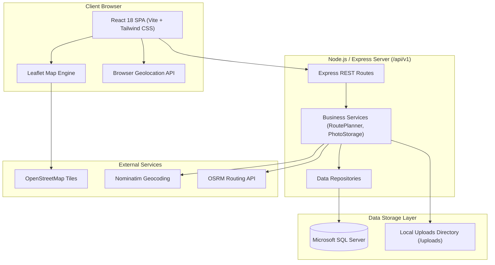

# Travel-Doc 🌍✈️

> A modern, full-stack personal travel guide and journey companion designed to discover destinations, curate travel wishlists, compute multi-stop itineraries from current location, log visited memoirs, and preserve memories through photos.

---

## 1. Project Purpose & Problem Statement
Planning travel often requires juggling multiple fragmented applications:
- Spreadsheets and note apps for bucket lists.
- Generic mapping tools lacking custom travel categories.
- Navigation tools that do not sequence stops intelligently from the traveler's current physical location.
- Isolated photo storage disconnected from journal notes and trip ratings.

**Travel-Doc** consolidates the entire travel journey into one unified, offline-resilient platform. It enables travelers to pin dream destinations, sequence multi-stop road routes with the **farthest-stop-first** heuristic, document authentic travel memoirs, and organize journey photos.

---

## 2. Key Features
- 📌 **Smart Travel Wishlist**: Add places via search and geocoding (Nominatim), set priorities, categories, planned dates, and personal notes. Duplicate prevention ensures clean records.
- 🗺️ **Interactive Leaflet Map**: Dynamic markers for wishlisted, visited, and selected places. Real-time synchronization without page reloads.
- 📍 **Browser Geolocation**: Secure, permission-based current location detection with explicit user consent and privacy protection.
- 🚗 **Multi-Stop Route Planner**:
  - Automatically identifies the **farthest unvisited destination** from the traveler's GPS location as **Stop #1**.
  - Sequences subsequent stops using an efficient nearest-neighbor algorithm.
  - Queries Open Source Routing Machine (OSRM) for authentic road-route geometry, travel distance, and driving duration.
  - Interactive stop reordering, removal, and recalculation.
- 📖 **Travel History Journal**: Record completed visits, assign 1-5 star ratings, capture trip memoirs, and track travel statistics (countries and cities visited).
- 📸 **Travel Photo Gallery**: Secure local upload handling via Multer with MIME validation and size limits, linked directly to destinations and visits.

---

## 3. Screenshots (UI Preview)

> *Screenshots will be updated as UI views are finalized during development.*

| Dashboard Overview | Interactive Wishlist & Map |
|---|---|
| *`[Placeholder: Dashboard with stats, recent activity, and map preview]`* | *`[Placeholder: Split-view Wishlist with Leaflet markers]`* |

| Multi-Stop Route Planner | Photo Gallery & Lightbox |
|---|---|
| *`[Placeholder: Route geometry connecting GPS to stops with farthest first]`* | *`[Placeholder: Responsive photo masonry grid with tags & lightbox]`* |

---

## 4. Technology Stack

- **Frontend**:
  - [React 18](https://react.dev/) + [Vite](https://vitejs.dev/)
  - [Tailwind CSS](https://tailwindcss.com/) (Nature-inspired organic palette)
  - [Leaflet](https://leafletjs.com/) & [React-Leaflet](https://react-leaflet.js.org/)
  - [React Router v6](https://reactrouter.com/)
  - [Axios](https://axios-http.com/)
  - [React Icons](https://react-icons.github.io/react-icons/)
- **Backend**:
  - [Node.js](https://nodejs.org/) (ES Modules)
  - [Express.js](https://expressjs.com/) REST API (`/api/v1`)
  - [mssql](https://www.npmjs.com/package/mssql) for Microsoft SQL Server
  - [Multer](https://github.com/expressjs/multer) for multipart photo uploads
  - Centralized error handling, CORS, and request logging
- **Database**:
  - [Microsoft SQL Server](https://www.microsoft.com/sql-server) (2019/2022/2025)
  - Normalized relational tables (`Places`, `WishlistItems`, `Visits`, `Photos`)
- **External Services**:
  - [OpenStreetMap](https://www.openstreetmap.org/) (Map Tiles)
  - [Nominatim](https://nominatim.openstreetmap.org/) (Geocoding API)
  - [OSRM](http://project-osrm.org/) (Road Routing Engine)

---

## 5. System Architecture



---

## 6. Project Folder Structure

```
Travel-Doc/
├── frontend/
│   ├── public/
│   ├── src/
│   │   ├── assets/
│   │   ├── components/
│   │   │   ├── common/        # Reusable UI controls (Buttons, Modals, Badges)
│   │   │   ├── layout/        # Sidebar, Header, MobileNav
│   │   │   ├── map/           # LeafletMap, CustomMarkers
│   │   │   ├── places/        # Wishlist cards, Place search
│   │   │   ├── trips/         # Route planner, Stop cards
│   │   │   └── gallery/       # Photo grid, Lightbox, Upload modal
│   │   ├── pages/             # Route views (Dashboard, Wishlist, Route, History, Gallery)
│   │   ├── hooks/             # Custom React hooks (useGeolocation, etc.)
│   │   ├── services/          # API, Geocoding, and Routing services
│   │   ├── utils/             # Haversine formula, formatting
│   │   └── main.jsx
│   ├── .env.example
│   ├── package.json
│   └── README.md
├── backend/
│   ├── src/
│   │   ├── config/            # DB and environment configuration
│   │   ├── controllers/       # API controllers
│   │   ├── services/          # Domain services (Routing heuristic, Uploads)
│   │   ├── repositories/      # SQL Server queries (mssql)
│   │   ├── routes/            # REST routes under /api/v1
│   │   ├── middleware/        # Error handlers, Multer upload
│   │   └── server.js          # Server entry point
│   ├── tests/                 # Automated test suites
│   ├── uploads/               # Safe local media directory (.gitkeep)
│   ├── .env.example
│   ├── package.json
│   └── README.md
├── database/
│   ├── schema.sql             # SQL Server DDL script
│   ├── seed.sql               # Sample destinations, visits, wishlist
│   ├── migrations/            # Version-controlled schema evolutions
│   └── README.md
├── docs/                      # Comprehensive technical documentation
├── scripts/                   # Setup and maintenance scripts
├── .gitignore
├── .editorconfig
├── CONTRIBUTING.md
├── LICENSE
└── README.md
```

---

## 7. Prerequisites & Environment Setup

- **Node.js**: v18.0.0 or later (v22+ recommended).
- **npm**: v9.0.0 or later.
- **Microsoft SQL Server**: 2019, 2022, or 2025 (Standard, Developer, or Express).
- **Command Line**: Windows PowerShell 5.1+ or PowerShell 7+ (macOS/Linux bash also supported).

---

## 8. Installation & Setup Guide

### 8.1 Database Initialization
Make sure your SQL Server service (`MSSQLSERVER` or your named instance) is running. Execute the schema script:
```powershell
# In Windows PowerShell:
sqlcmd -S localhost -E -C -i database/schema.sql

# (Optional) Seed realistic sample destinations and visits:
sqlcmd -S localhost -E -C -i database/seed.sql
```

### 8.2 Backend Setup
```powershell
# Navigate to backend directory
cd backend

# Install dependencies
npm install

# Create environment file from template
Copy-Item .env.example .env

# Start backend server
npm run dev
```
The API server will start on `http://localhost:5000`.

### 8.3 Frontend Setup
```powershell
# In a new terminal, navigate to frontend directory
cd frontend

# Install dependencies
npm install

# Create environment file from template
Copy-Item .env.example .env

# Start Vite development server
npm run dev
```
The frontend application will be live at `http://localhost:5173`.

---

## 9. Configuration & Environment Variables

### Backend (`backend/.env`)
```env
PORT=5000
NODE_ENV=development
CLIENT_URL=http://localhost:5173

# Microsoft SQL Server
DB_SERVER=localhost
DB_DATABASE=TravelDocDB
DB_PORT=1433
DB_USER=
DB_PASSWORD=
DB_ENCRYPT=false
DB_TRUST_SERVER_CERTIFICATE=true

# Upload Limits
UPLOAD_DIR=uploads
MAX_FILE_SIZE_BYTES=5242880
```

### Frontend (`frontend/.env`)
```env
VITE_API_BASE_URL=http://localhost:5000/api/v1
```

---

## 10. Running Tests & Quality Checks

```powershell
# Run backend test suite
cd backend
npm test

# Run frontend tests
cd ../frontend
npm test
```

---

## 11. REST API Endpoints Overview

| Method | Endpoint | Description |
|---|---|---|
| `GET` | `/api/v1/health` | Service and database health check |
| `GET` | `/api/v1/places` | List and search destinations |
| `POST` | `/api/v1/places` | Create new place |
| `GET` | `/api/v1/wishlist` | Get wishlist destinations |
| `POST` | `/api/v1/wishlist` | Add place to wishlist |
| `PATCH` | `/api/v1/wishlist/:id` | Update wishlist item |
| `DELETE` | `/api/v1/wishlist/:id` | Delete wishlist item |
| `POST` | `/api/v1/routes/plan` | Generate multi-stop itinerary (farthest first) |
| `GET` | `/api/v1/visits` | Get travel history |
| `POST` | `/api/v1/visits` | Record a visit |
| `GET` | `/api/v1/photos` | List photo gallery |
| `POST` | `/api/v1/photos` | Upload photo (multipart/form-data) |
| `GET` | `/api/v1/dashboard/summary` | Aggregate dashboard statistics |

---

## 12. Routing & Geolocation Details
- **Farthest-First Rule**: The route planner computes straight-line distances from the user's GPS coordinates using the Haversine formula. The destination furthest from origin is designated **Stop #1**. Subsequent stops are arranged via nearest neighbor. Road route geometry is retrieved from OSRM.
- **Privacy**: The browser Geolocation API is invoked only upon explicit user interaction ("Locate Me"). Location data is never transmitted to third parties or logged in the database without direct user intent.

---

## 13. License
This project is licensed under the [MIT License](LICENSE).
