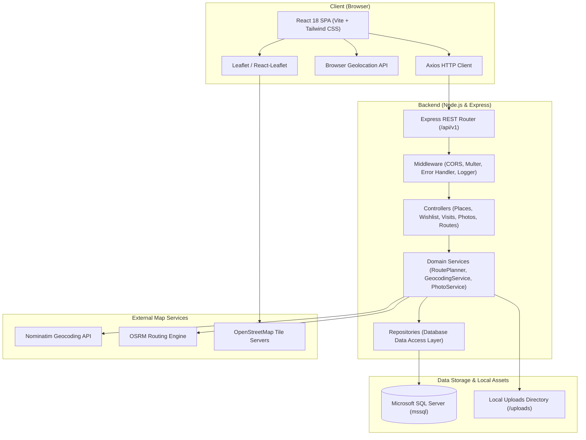
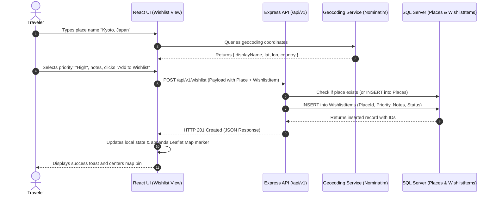
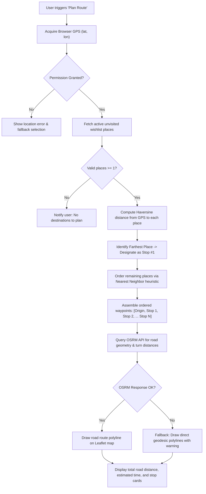

# Travel-Doc — System Architecture

## 1. System Overview
Travel-Doc is engineered as a decoupled full-stack web application with a React SPA frontend and a Node.js/Express RESTful backend connected to Microsoft SQL Server. External map rendering, geocoding, and routing are orchestrated via OpenStreetMap, Nominatim, and OSRM.

---

## 2. System Architecture Diagram

---

## 3. Main Application Data Flow

---

## 4. Route-Planning Workflow

The route planner connects the traveler's current location to their active wishlist destinations. A core product requirement is that **the farthest destination from the origin must be visited first**, followed by a nearest-neighbor sequence for remaining stops.

---

## 5. Architectural Principles & Layering
1. **Separation of Concerns**:
   - `routes/`: Define endpoint URL paths and attach validation middleware.
   - `controllers/`: Handle HTTP requests, status codes, and formatting.
   - `services/`: Encapsulate core business logic (e.g. Haversine distance, itinerary sequencing).
   - `repositories/`: Pure SQL query execution using parameterized inputs via `mssql`.
2. **Resilience & Fallbacks**:
   - Geocoding and routing services are behind abstracted service modules with fallback strategies.
   - If external routing fails, UI renders straight-line visual connectors with clear notices.
3. **Security Standards**:
   - Centralized input validation using Zod/express-validator.
   - Safe file uploads: MIME type inspection, file extension whitelist, UUID file naming.
   - CORS origin configuration and defensive header settings.
