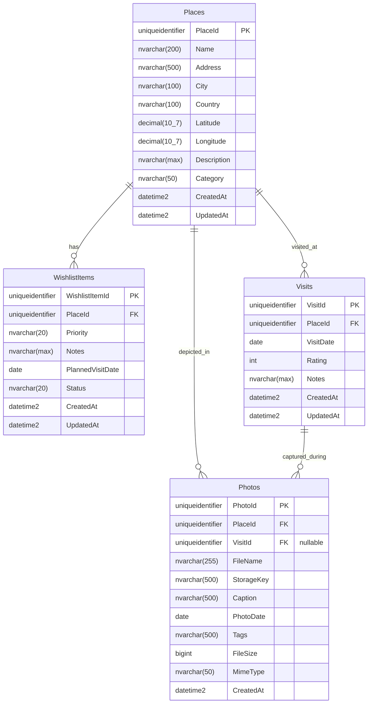

# Travel-Doc — Database Schema Design

## 1. Overview
The database layer is hosted on Microsoft SQL Server. The schema is normalized into 4 primary relational entities:
- `Places`: Geocoded real-world destinations.
- `WishlistItems`: User's travel desires with priority, planned dates, and status.
- `Visits`: Historical log of real journeys to a destination, supporting repeat visits.
- `Photos`: Media asset metadata associated with places and visits.

---

## 2. Entity-Relationship (ER) Diagram

---

## 3. Data Dictionary & Table Definitions

### 3.1 Table: `Places`
Stores geocoded destination identities. Duplicate locations can be identified by coordinate proximity or unique name+city+country.

| Column | Type | Nullable | Description |
|---|---|---|---|
| `PlaceId` | `UNIQUEIDENTIFIER` | NO | Primary key (DEFAULT `NEWID()`) |
| `Name` | `NVARCHAR(200)` | NO | Place or attraction name |
| `Address` | `NVARCHAR(500)` | YES | Formatted street address |
| `City` | `NVARCHAR(100)` | YES | City name |
| `Country` | `NVARCHAR(100)` | NO | Country name |
| `Latitude` | `DECIMAL(10, 7)` | NO | Latitude coordinate (-90 to 90) |
| `Longitude` | `DECIMAL(10, 7)` | NO | Longitude coordinate (-180 to 180) |
| `Description` | `NVARCHAR(MAX)` | YES | Optional descriptive notes or overview |
| `Category` | `NVARCHAR(50)` | NO | E.g. Nature, Culture, Historic, Culinary, Urban |
| `CreatedAt` | `DATETIME2` | NO | Timestamp of creation (DEFAULT `SYSUTCDATETIME()`) |
| `UpdatedAt` | `DATETIME2` | NO | Timestamp of last modification |

**Indexes**:
- `IX_Places_Coords`: `(Latitude, Longitude)`
- `IX_Places_Country_City`: `(Country, City)`

---

### 3.2 Table: `WishlistItems`
Links to a `PlaceId`. Enforces that active unvisited wishlist entries remain distinct.

| Column | Type | Nullable | Description |
|---|---|---|---|
| `WishlistItemId` | `UNIQUEIDENTIFIER` | NO | Primary Key (DEFAULT `NEWID()`) |
| `PlaceId` | `UNIQUEIDENTIFIER` | NO | Foreign Key -> `Places(PlaceId)` |
| `Priority` | `NVARCHAR(20)` | NO | Priority level: `High`, `Medium`, `Low` |
| `Notes` | `NVARCHAR(MAX)` | YES | Personal travel aspirations/notes |
| `PlannedVisitDate`| `DATE` | YES | Target travel date |
| `Status` | `NVARCHAR(20)` | NO | `Pending`, `Visited`, `Archived` (DEFAULT `Pending`) |
| `CreatedAt` | `DATETIME2` | NO | Creation timestamp (DEFAULT `SYSUTCDATETIME()`) |
| `UpdatedAt` | `DATETIME2` | NO | Update timestamp |

**Constraints & Indexes**:
- `FK_WishlistItems_Places`: Foreign key to `Places(PlaceId)` with `ON DELETE CASCADE`
- `UQ_Wishlist_Place_Active`: Unique filtered index on `(PlaceId)` WHERE `Status = 'Pending'` to prevent duplicate wishlist items.

---

### 3.3 Table: `Visits`
Maintains a separate historical log for each visit. A traveler can visit the same place multiple times.

| Column | Type | Nullable | Description |
|---|---|---|---|
| `VisitId` | `UNIQUEIDENTIFIER` | NO | Primary Key (DEFAULT `NEWID()`) |
| `PlaceId` | `UNIQUEIDENTIFIER` | NO | Foreign Key -> `Places(PlaceId)` |
| `VisitDate` | `DATE` | NO | Date of visit |
| `Rating` | `INT` | YES | 1 to 5 star rating (CHECK `Rating BETWEEN 1 AND 5`) |
| `Notes` | `NVARCHAR(MAX)` | YES | Trip memoir, travel tips, memorable moments |
| `CreatedAt` | `DATETIME2` | NO | Creation timestamp (DEFAULT `SYSUTCDATETIME()`) |
| `UpdatedAt` | `DATETIME2` | NO | Update timestamp |

**Constraints & Indexes**:
- `FK_Visits_Places`: Foreign key to `Places(PlaceId)` with `ON DELETE CASCADE`
- `IX_Visits_VisitDate`: Index on `(VisitDate DESC)` for chronological ordering

---

### 3.4 Table: `Photos`
Stores uploaded photo metadata. Associated with a place, and optionally with a specific visit.

| Column | Type | Nullable | Description |
|---|---|---|---|
| `PhotoId` | `UNIQUEIDENTIFIER` | NO | Primary Key (DEFAULT `NEWID()`) |
| `PlaceId` | `UNIQUEIDENTIFIER` | NO | Foreign Key -> `Places(PlaceId)` |
| `VisitId` | `UNIQUEIDENTIFIER` | YES | Optional Foreign Key -> `Visits(VisitId)` |
| `FileName` | `NVARCHAR(255)` | NO | Original uploaded file name |
| `StorageKey` | `NVARCHAR(500)` | NO | Relative storage path / generated file name |
| `Caption` | `NVARCHAR(500)` | YES | Description of the photo |
| `PhotoDate` | `DATE` | YES | Date picture was taken |
| `Tags` | `NVARCHAR(500)` | YES | Comma-delimited tags (e.g. `sunset, hike, food`) |
| `FileSize` | `BIGINT` | NO | File size in bytes |
| `MimeType` | `NVARCHAR(50)` | NO | MIME type (e.g., `image/jpeg`, `image/png`) |
| `CreatedAt` | `DATETIME2` | NO | Upload timestamp (DEFAULT `SYSUTCDATETIME()`) |

**Constraints & Indexes**:
- `FK_Photos_Places`: Foreign key to `Places(PlaceId)` with `ON DELETE CASCADE`
- `FK_Photos_Visits`: Foreign key to `Visits(VisitId)` with `ON DELETE SET NULL`
- `IX_Photos_PlaceId`: Index on `(PlaceId)`
- `IX_Photos_CreatedAt`: Index on `(CreatedAt DESC)`
